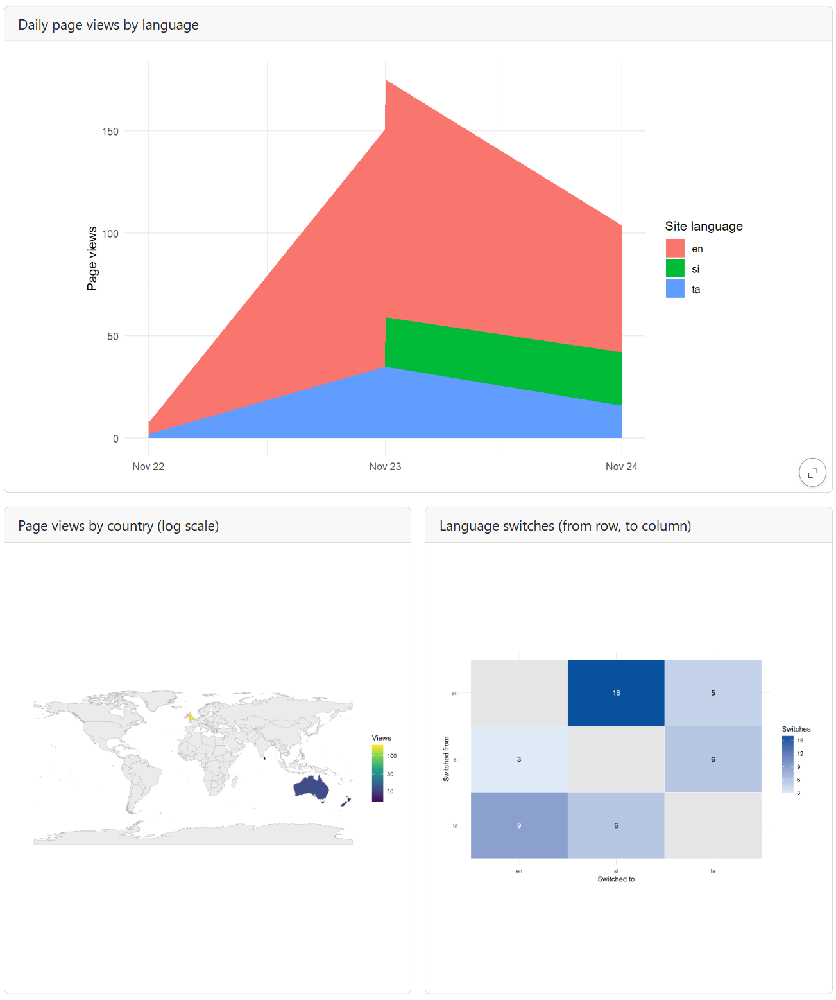
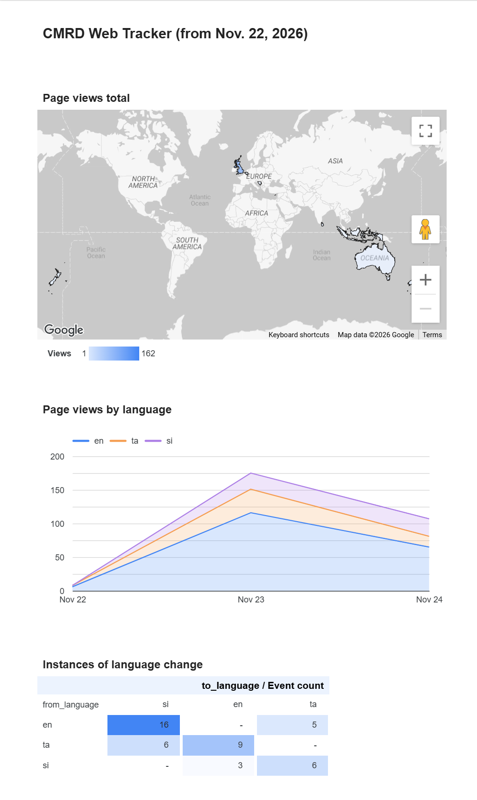
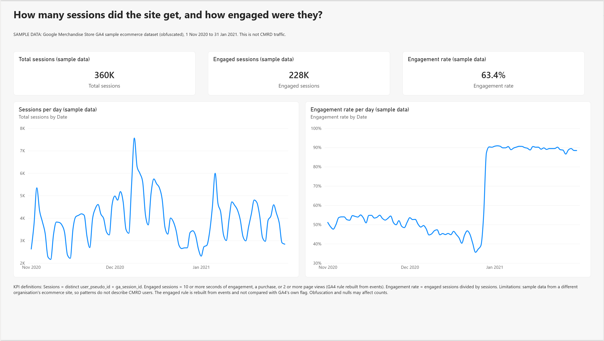
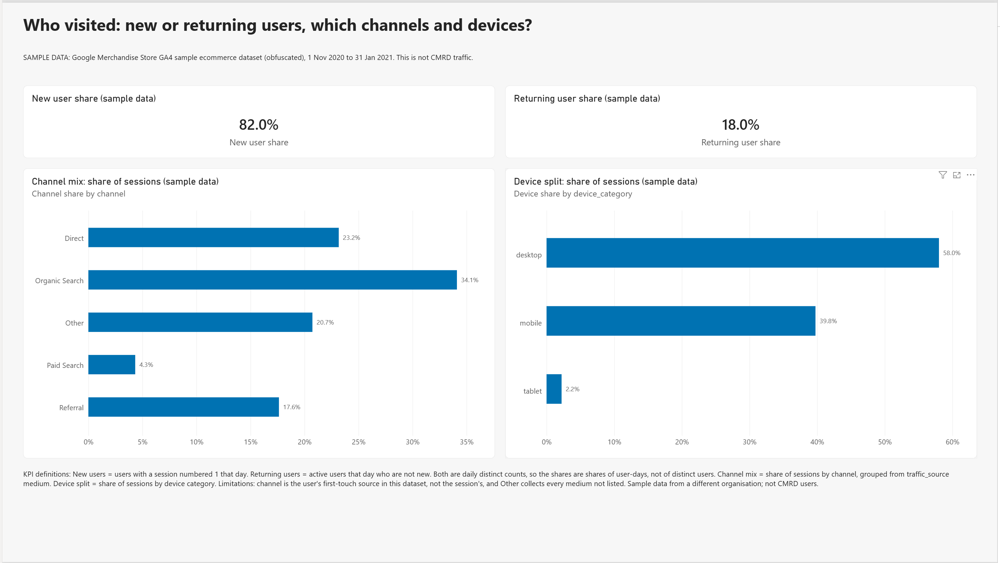
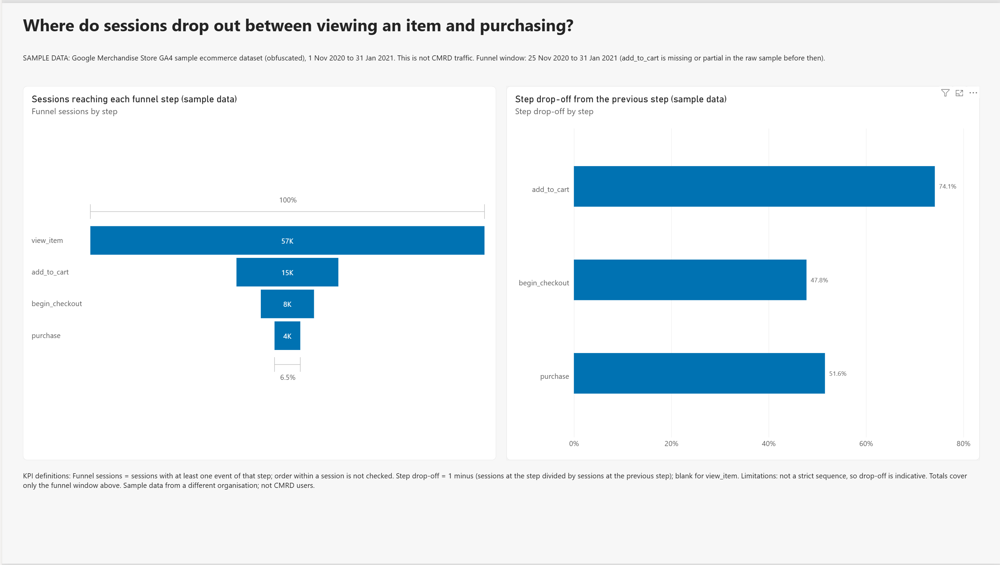
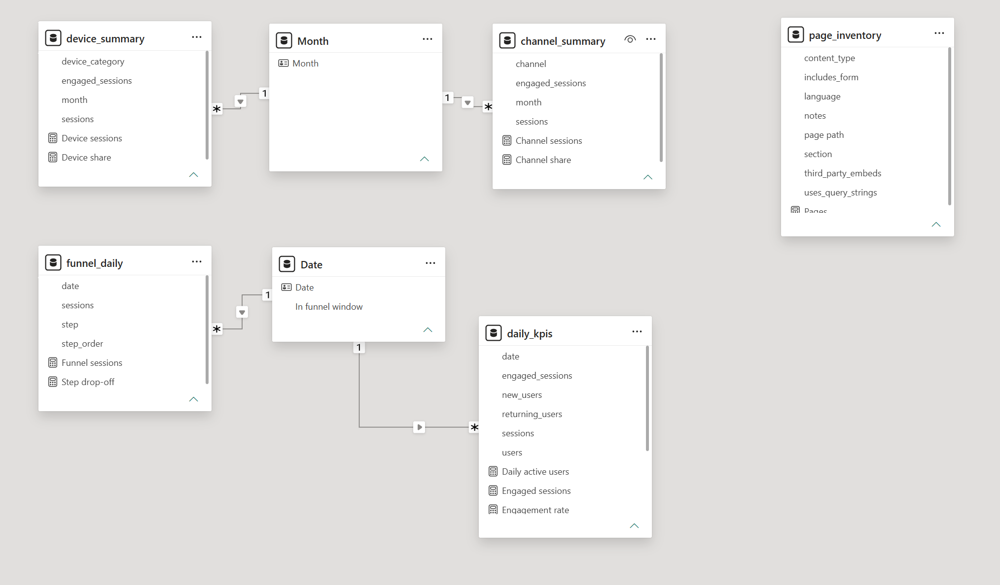
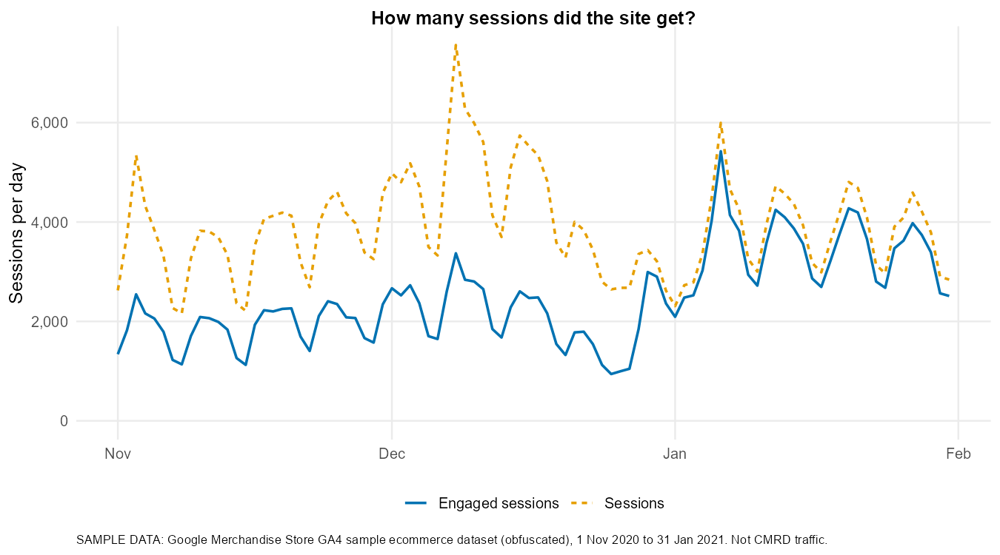
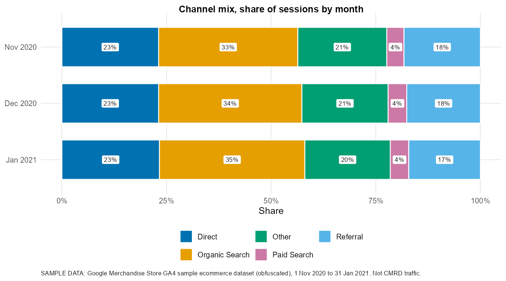
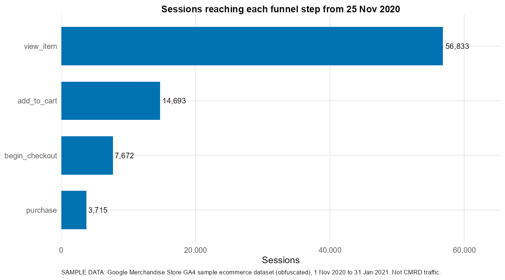
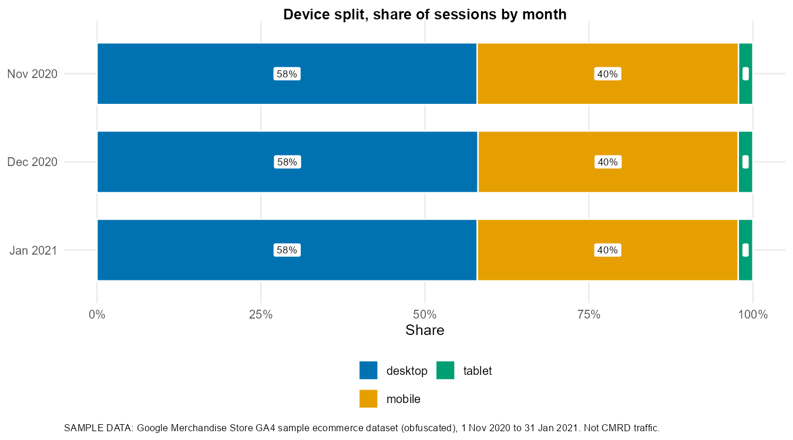

# GA4 and GTM performance analytics

A real Google Analytics 4 (GA4) and Google Tag Manager (GTM) project for a live website, plus a full-scale demonstration of the same measurement thinking in R, Python and Power BI. It is a portfolio project for performance-analyst roles in UK public-sector digital services.

## The two parts

| Part | What it is | Data |
|---|---|---|
| [**CMRD web analytics**](cmrd-analytics/README.md) (`cmrd-analytics/`) | A working GA4 and GTM set-up for the trilingual website of the Centre for Migration Research and Development (CMRD), reported in an R / Quarto dashboard | Real GA4 data, pulled through the GA4 Data API (a few days so far), with synthetic demo data for the dashboard until more accumulates |
| **GA4 sample dashboards** (this README, below) | The same KPI views built three ways: Power BI, R (Quarto) and Python (pandas and Plotly) | Google's public GA4 sample ecommerce data (sample data, obfuscated) |

## What the CMRD project did, in short

The Centre for Migration Research and Development (CMRD) is a Sri Lanka based, research-focused charity. Its website, www.cmrd.lk, is used by research professionals and students, especially those working on migration or Sri Lanka.

The project put a version-controlled, staged copy of the CMRD site under change control. It added one Google Tag Manager block to the shared page template, and a small PHP allowlist that pushes only language, section and content type to the dataLayer ([the snippet, with the container ID removed](cmrd-analytics/gtm-datalayer.md)). GTM sends page views, and a `language_switch` event, to GA4. The GA4 events can't be built from GA4 alone, because a language link is an ordinary link. An R script pulls aggregated daily views, countries and switch counts from the GA4 Data API. It saves them as CSV files that outlive GA4's limits, strips URLs, and suppresses small cells. A Quarto dashboard turns them into an area chart, a country map and a 3x3 switch heat map.

This is a real GA4 and GTM project, with features that actually need GTM. It works: data is uploaded to GA4 and downloaded here through the API.

## Evidence that the CMRD tracking works

Two independent dashboards read the same GA4 property: the R / Quarto dashboard in this repo (from the CSV archive in `data/cmrd/real/`) and a Looker Studio (Google Data Studio) report connected to GA4 directly. Both show page views by language, page views by country and the language-switch counts for 22 to 24 November 2026. The switch counts match between the two (en to si 16, en to ta 5, si to en 3, si to ta 6, ta to en 9, ta to si 6), which suggests the GTM events and the API pull are working as intended.

| R / Quarto dashboard (`cmrd-analytics/dashboard.qmd`) | Looker Studio dashboard (direct from GA4) |
|---|---|
|  |  |

The same screenshots also show why the CMRD data cannot carry a full KPI set yet. There are only three days of data (22 to 24 November 2026), a handful of countries, and some of the traffic is test visits by the site manager. Three points cannot support trends, engagement rates, channel comparisons or a conversion funnel. That is the reason for the GA4 sample demonstration below.

## Why there is also a GA4 sample demonstration

The CMRD site is new, so there is little data to work with yet, and a few days of traffic (partly the site manager's own test visits) cannot support a full set of performance KPIs. To show the full method (sessions, engagement, channels, devices and a conversion funnel, in three tools), the second part uses Google's public GA4 sample ecommerce data. That data has limits of its own: it is a static, obfuscated export from the Google Merchandise Store delivered through BigQuery, not a live site with GA4 and GTM linked to it. Its purchase funnel and audience belong to a shop, so they say nothing about CMRD's users. It demonstrates the measurement logic and nothing more.

The CMRD material does not appear in the Power BI, R and Python sample dashboards below; it has its own Quarto dashboard in `cmrd-analytics/`.

Rendered dashboards (self-contained HTML, download and open in a browser): [CMRD web analytics](docs/cmrd-dashboard.html) (real GA4 data, a few days so far), and the GA4 sample dashboards in [R / Quarto](docs/r-dashboard.html) and [Python / Plotly](docs/python-dashboard.html). They are not hosted yet; to publish them, enable GitHub Pages on the `docs/` folder.

## Power BI dashboard preview

Screenshots of the Power BI report, for readers who do not run the project. All pages show **GA4 sample data**. Each page title is the question it answers.

| | |
|---|---|
|  |  |
| *How many sessions did the site get, and how engaged were they?* | *Who visited: new or returning users, which channels and devices?* |
|  |  |
| *Where do sessions drop out between viewing an item and purchasing?* | *Semantic model: tables, relationships and measures* |

The R and Python dashboards cover the same KPIs.

## R dashboard chart previews

PNG exports of the R charts (`r-dashboard/04_export_previews.R`), shown here because the rendered HTML is not yet published. All charts use **GA4 sample data**.

| | |
|---|---|
|  |  |
|  |  |

All six previews are in `docs/images/` (`r-01` to `r-06`).

## Repo map

| Path | Contents |
|---|---|
| `cmrd-analytics/` | The real CMRD GA4 and GTM project: Quarto dashboard, GTM data layer snippet |
| `docs/dashboard-spec.md` | Audience, questions, data contract, KPI definitions, refresh method, limitations |
| `dbt/` | dbt-bigquery project that builds the four marts from the public GA4 sample |
| `sql/` | Plain-SQL fallback (not created; dbt works) |
| `data/GA4-demo/` | Aggregated mart CSVs (committed; GA4 Google Merchandise Store sample data) |
| `data/cmrd/` | CMRD data: real GA4 archive, synthetic demo data, page inventory, data dictionary |
| `r-dashboard/` | R scripts: refresh data, validate data, render the Quarto dashboard |
| `python-dashboard/` | Script that builds the Python dashboard |
| `power-bi/` | Power BI Project (PBIP): semantic model, measures, README |
| `docs/` | Rendered dashboards for GitHub Pages |
| `docs/images/` | Power BI, R and CMRD dashboard screenshots used in this README |

## Reproduce the sample dashboards (no login needed)

The committed CSVs are enough to validate and rebuild every dashboard.

```r
# R: install.packages(c("readr", "dplyr", "ggplot2", "scales", "tidyr", "here", "knitr", "rmarkdown"))
source("r-dashboard/02_validate_data.R")   # 14 checks on the data contract
source("r-dashboard/render.R")             # needs Quarto; writes docs/r-dashboard.html
```

```
pip install -r requirements.txt
python python-dashboard/build_dashboard.py   # writes docs/python-dashboard.html
```

Power BI: open `power-bi/GA4demo.pbip` in Power BI Desktop (Windows) and set the `DataFolder` parameter to your `data/GA4-demo` folder. Details in `power-bi/README.md`. Without Desktop, use the screenshots above.

## Refresh the data (optional, needs a Google account)

Only needed if the dbt logic changes. BigQuery bills queries to your own project (the free sandbox is enough). No key file is used; sign-in is in the browser. See `dbt/README.md` for the one-time setup, then:

```r
Sys.setenv(GCP_PROJECT_ID = "your-gcp-project-id")
source("r-dashboard/01_get_data.R")
source("r-dashboard/02_validate_data.R")
```

## Data sources and attribution

- GA4 sample ecommerce dataset, `bigquery-public-data.ga4_obfuscated_sample_ecommerce`, provided by Google (Google Merchandise Store, 1 Nov 2020 to 31 Jan 2021). Its licence and terms are set by Google on the dataset's BigQuery listing and are not restated here; check them before reusing the data.
- CMRD web analytics (`cmrd-analytics/`): data from CMRD's own GA4 property, shared with CMRD's agreement to be named. Its demo data is synthetic.

## Limitations

- The sample dashboards use a different organisation's ecommerce data, obfuscated; patterns do not describe CMRD users.
- Engaged sessions are rebuilt from events (10 or more seconds, a purchase, or 2 or more page views). Compared with the sample's own `session_engaged` flag (`r-dashboard/05_check_engagement_rule.R`), it runs a few points lower.
- Channel is first-touch (user level) in this dataset.
- The daily engagement rate steps from about 40% to about 90% on 28 to 29 December 2020. It is driven by the share of sessions with 2 or more page views (about a third before, about 85 to 90% after), and the sample's own `session_engaged` flag jumps too, so the step is in the sample data, not the rule. The reason is unknown (possibly a tracking change); do not read it as a change in user behaviour. See `docs/dashboard-spec.md` and `r-dashboard/05_check_engagement_rule.R`.
- Known limitation: the rebuilt rule uses only the events the staging model keeps, so it runs about 4 to 5 points below the sample's flag early on and about 1 point after. This was left as built; the gap is documented in `docs/dashboard-spec.md`.
- The funnel is shown from 2020-11-25 because the raw sample lacks add_to_cart events on most days before then. Steps are not sequence-checked.
- User counts are daily distinct, so new and returning shares are shares of user-days.
- The Power BI project opens and renders in Power BI Desktop (October 2026 release). It has three pages and uses the default theme apart from Okabe-Ito series colours.

## Privacy

Only aggregated counts are stored, in both parts (the CMRD files have no URLs and suppress small cells). `user_pseudo_id` never leaves BigQuery. No credentials, keys, project ids or personal paths are committed; a pre-commit hook (`git config core.hooksPath .githooks`) blocks common leaks.

## Licence

Code: MIT (`LICENSE`).
